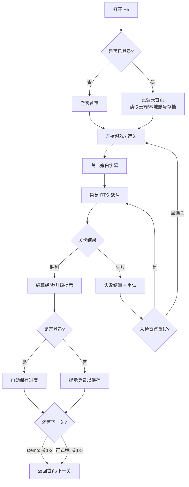
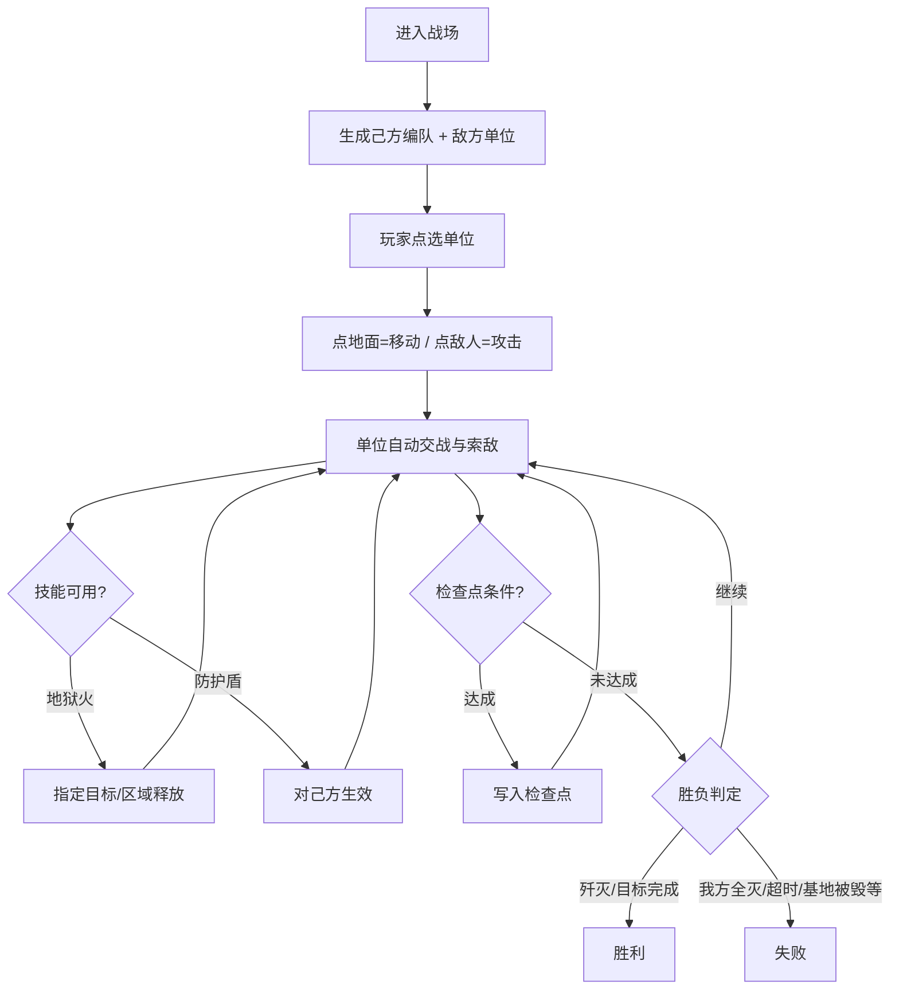
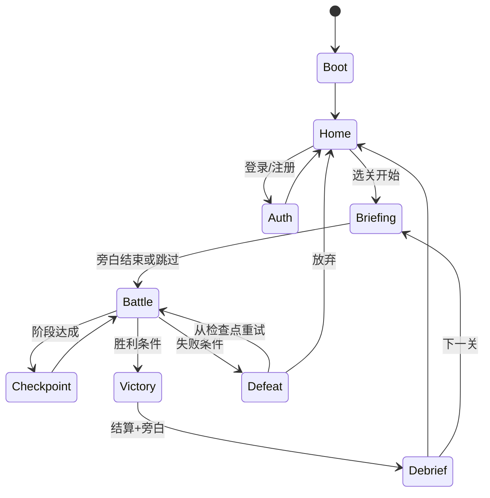

# 《中途岛：海空决战》产品需求文档（PRD）

版本号：V3.0.0

| 版本 | 时间 | 修订人 | 备注 |
|------|------|--------|------|
| V1.1 | 2026/11/14 | — | 儿童向横屏射击（历史骨架） |
| V2.0 | 2026/11/15 | — | 成年向竖屏写实重定位（需求梳理） |
| V3.0.0 | 2026/11/16 | PM | 基于最新确认：青少年 / 简易 RTS / 单机+可选账号存档 / 旁白科普 / Demo 优先 |

**文档状态**：评审稿  
**本版本范围**：完整需求说明；**开发优先交付 Demo（关卡 1–2 + 核心循环）**；五关内容完整定义但非 Demo 必做。  
**与旧版关系**：题材与「五关 + 历史旁白」骨架可沿用；玩法、用户、存档、成长、调性以本版为准，覆盖 V1.1 / V2.0 冲突条款。

---

## 一、概述（为什么做）

### 1.1 产品概述及目标

#### 1.1.1 背景介绍

中途岛战役是太平洋战争的转折点，具备清晰的时间线、戏剧冲突与可教学节点。现有网页游戏方案在「儿童卡通射击」与「成年写实射击」之间摇摆，尚未落地一版同时满足：

1. **可玩的策略对抗**（而非纯反应型射击）；
2. **面向青少年的历史科普**（有故事、有因果，而非纯打斗）；
3. **轻量纯前端、手机浏览器可玩**；
4. **可选账号存档**，降低丢失进度的挫败感。

本产品将上述诉求收敛为：**简易 RTS + 历史旁白字幕 + 虚构关卡承载真实战役脉络**。

#### 1.1.2 产品概述

《中途岛：海空决战》是一款运行于手机浏览器的**单机简易 RTS 网页游戏**。玩家指挥己方战机编队，完成对敌战机、驱逐舰、航母群的作战任务；通过击毁目标获取经验，升级机体血量与机型，并解锁「地狱火导弹」「防护盾」技能。五关以**历史旁白 + 虚构关卡目标**串联中途岛战役科普故事线；游客可完整试玩，**登录账号后自动保存进度与检查点**。

#### 1.1.3 产品目标

**业务目标**

| 目标 | 指标 | 目标值 | 达成时间 |
|------|------|--------|---------|
| Demo 可演示 | 可公开演示的完整闭环（教程→战斗→升级→存档） | 关卡 1–2 可通关 | Demo 里程碑 |
| 叙事有效 | 玩家能复述战役核心因果 | Demo 内嵌 3 个可测知识点 | Demo 内测 |
| 留存动机 | 登录后继续游玩意愿 | 试玩后登录转化率 ≥ 20% **[假设]** | 正式版上线后 1 个月 |
| 完整版完成度 | 五关 + 成长闭环可通关 | 五关通关率 ≥ 60%（青少年样本）**[假设]** | 正式版 |

**用户目标**

| 目标用户 | 用户目标 | 衡量指标 |
|---------|---------|---------|
| 青少年玩家 | 在策略操作中理解「为何中途岛重要」 | 通关后能答对 ≥ 2/3 旁白相关知识点 |
| 青少年玩家 | 指挥战机击败舰机并感受到成长 | 单次会话内至少完成 1 次升级 |
| 游客玩家 | 无账号也能立刻开玩 | 从打开页面到进入第一场战斗 ≤ 30 秒 |
| 登录玩家 | 中断后可从检查点续玩 | 刷新页面后进度恢复成功率 100%（同账号） |

#### 1.1.4 目标用户

| 角色 | 描述 | 核心诉求 |
|------|------|---------|
| 青少年玩家（约 12–17 岁） | 对军事/历史有兴趣，能接受策略操作与一定挫败 | 好玩、有成长、能看懂故事 |
| 游客（未登录） | 首次访问、不愿先注册 | 零门槛试玩 |
| 注册用户 | 希望保留进度 | 自动存档、跨会话续玩 |
| 开发/测试/评审 | 内部验收 | 可复现关卡与验收清单 |

### 1.2 名词说明

| 名词 | 说明 |
|------|------|
| 简易 RTS | 轻量即时战略：点选单位、下达移动/攻击指令、管理少量技能与单位，无复杂经济建造 |
| 航母群 | 关卡内以航母为核心、可含护航单位的敌方编队目标 |
| 检查点 | 关卡内达成阶段目标后写入的可恢复进度点 |
| 旁白字幕 | 关卡开始/阶段切换/结算时底部（或顶部）滚动/逐句历史科普文案 |
| 地狱火导弹 | 主动技能：对指定区域或目标造成高额伤害（冷却制） |
| 防护盾 | 主动技能：短时间内降低己方单位所受伤害或抵挡一次致命伤害 **[假设：减伤护盾]** |
| 机型 | 可升级的战机外观与基础属性档位（血量/火力等） |
| Demo | 首期可玩版本：核心循环 + 关卡 1–2 + 账号存档最小闭环 |
| 游客模式 | 不登录可玩；进度仅存于当前会话内存，刷新/关闭即丢失（可提示登录） |

### 1.3 角色及权限

| 角色 | 权限范围 | 数据范围 |
|------|---------|---------|
| 游客 | 开始游戏、游玩全部已开放关卡、查看图鉴/设置；不可云端存档 | 仅本机会话 |
| 注册用户（已登录） | 游客全部权限 + 自动存档/读档、查看战绩摘要 | 本人账号存档 |
| 系统 | 校验关卡解锁、写入检查点、结算经验 | — |

> **[假设]** Demo 不设管理员后台；账号体系采用轻量方案（见 4.5）。

### 1.4 文档阅读对象

| 对象 | 关注内容 |
|------|---------|
| 研发 | 功能需求、状态机、数据字典、存档结构、异常流程 |
| UI/UX | 竖屏布局、RTS 操作热区、旁白字幕、HUD |
| 测试 | 验收标准、失败/重试/存档边界 |
| 策划/内容 | 五关目标、旁白文案、难度与数值 |
| 美术 | 载具白底参考图落地规范（见附录与待确认项） |

---

## 二、产品描述（做什么）

### 2.1 产品需求描述

产品需同时满足「策略可玩」与「历史可读」：

1. **策略层**：玩家在海空战场上点选己方战机，下达移动与攻击指令；对抗敌战机、驱逐舰、航母群。
2. **成长层**：击毁目标获经验 → 升级血量与机型 → 解锁/强化技能（地狱火、防护盾）。
3. **叙事层**：每关以旁白字幕交代历史背景与本关「虚构任务」的关系；战斗过程与阶段切换穿插短旁白，强化科普而非仅刷怪。
4. **账号层**：可匿名开玩；登录后自动保存关卡进度、检查点、经验与机型。
5. **技术层**：纯前端实现，主适配手机浏览器竖屏；桌面浏览器可用但不作为优先体验。

**非目标（本版明确不做）**

- 不做真实联机对战、实时 PVP。
- 不做重型经济建造（采矿、造建筑、科技树多层）。
- 不做完整飞行模拟（油量、失速、仪表）。
- 不做对标《1942》《空战名将》的画风或操作范式。
- Demo 不做完整五关实现（五关需在需求中定义清楚，供正式版排期）。

### 2.2 产品整体流程

#### 2.2.1 主流程



#### 2.2.2 战斗子流程（简易 RTS）



#### 2.2.3 存档数据流（登录用户）


> **[假设]** Demo 账号存档优先用「纯前端 + 第三方 Auth / BaaS 或自建极简 API」之一；若暂无后端，可用 `localStorage` 按用户 ID 隔离，并在文档中标注为临时方案（见 4.5）。

#### 2.2.4 核心状态转换



### 2.3 全局说明

#### 2.3.1 异常处理

| 场景 | 处理 |
|------|------|
| 网络不可用（游客） | 正常游玩；登录入口提示「需网络」 |
| 网络不可用（已登录存档同步失败） | 先写本地；顶部弱提示「进度已保存在本机，联网后同步」**[假设]** |
| 登录失败 | Toast「登录失败，请重试」；可继续游客模式 |
| 存档损坏/版本不兼容 | 提示并回退到最近合法检查点或关卡开始；上报错误日志（若有） |
| 页面切到后台 | 战斗自动暂停 |
| 误触刷新 | 已登录：恢复至最近自动存档；游客：进度丢失并在再次进入时提示登录 |
| 技能冷却中点击 | 按钮置灰 + 短提示「冷却中」 |
| 无单位可选时点空地 | 无操作，可轻震动/音效提示 |

#### 2.3.2 列表与选关规则

- 关卡列表按 1→5 顺序展示；未解锁关卡灰显，点击提示「请先完成上一关」。
- Demo 仅开放关卡 1–2；关卡 3–5 显示「即将开放」或隐藏入口（二选一，见待确认项）。
- 已通关关卡可重玩；重玩仍获得经验但可设每日/单次衰减 **[假设：Demo 不做衰减]**。

#### 2.3.3 全局交互

- **主适配**：手机竖屏；最小触控热区 44×44px（推荐 48×48）。
- **旁白**：默认可读；提供「跳过旁白」；首次进入某关不可跳过 **[假设：可跳过，但首次建议完整播放]**。
- **暂停**：战斗中右上角暂停；暂停菜单含继续 / 重试检查点 / 返回首页。
- **音效**：BGM/SFX 可关；默认开 **[假设]**。
- **语言**：Demo 仅简体中文。

### 2.4 产品版本规划

| 版本 | 范围 | 目标 |
|------|------|------|
| **Demo（本期）** | 引导 + 关卡 1–2；战机 vs 战机、战机 vs 驱逐舰；经验/血量/机型升级；地狱火 + 防护盾；旁白字幕；游客可玩；登录自动存档与检查点 | 可对外演示的完整核心循环 |
| V1.0 正式版 | 五关全部；航母群作战完整化；图鉴/成就可选；存档同步稳定；数值与难度打磨 | 完整故事线可通关 |
| 后续（可选） | 更多机型、成就分享、排行榜、简易教程关扩展 | 留存与传播 |

### 2.5 产品框架

```text
┌─────────────────────────────────────┐
│ 启动 / 资源加载                      │
├─────────────────────────────────────┤
│ 首页：开始 / 选关 / 登录 / 设置       │
├──────────────┬──────────────────────┤
│ 旁白字幕层    │ 战斗 HUD（资源/技能）  │
│ Briefing     │ 简易 RTS 战场         │
├──────────────┴──────────────────────┤
│ 结算 / 升级 / 存档提示                │
├─────────────────────────────────────┤
│ 账号：注册登录 · 进度存储             │
└─────────────────────────────────────┘
```

### 2.6 功能清单

| ID | 功能 | 优先级 | 版本 |
|----|------|--------|------|
| F01 | 启动加载与首页 | P0 | Demo |
| F02 | 游客开玩 | P0 | Demo |
| F03 | 注册 / 登录 | P0 | Demo |
| F04 | 关卡选择与解锁 | P0 | Demo（1–2） |
| F05 | 关卡旁白字幕（开场/阶段/结算） | P0 | Demo |
| F06 | 简易 RTS：点选、移动、攻击 | P0 | Demo |
| F07 | 敌方：战机、驱逐舰 | P0 | Demo |
| F08 | 敌方：航母群 | P1 | Demo 可用简化版；正式版完整 |
| F09 | 胜负判定与失败重试 | P0 | Demo |
| F10 | 检查点 | P0 | Demo |
| F11 | 经验、升级血量与机型 | P0 | Demo |
| F12 | 技能：地狱火导弹 | P0 | Demo |
| F13 | 技能：防护盾 | P0 | Demo |
| F14 | 登录后自动存档 / 读档 | P0 | Demo |
| F15 | 暂停与设置（音效等） | P1 | Demo |
| F16 | 载具图鉴（科普向） | P2 | 正式版 |
| F17 | 成就 | P2 | 正式版 |
| F18 | 关卡 3–5 | P0 | 正式版 |
| F19 | 埋点（本地或上报） | P2 | Demo 可先本地 |

---

## 三、功能需求（怎么做）

### 3.1 F01 启动加载与首页

**描述**  
加载必要资源后进入首页，提供开始游戏、选关、登录、设置入口。

**用户故事**  
作为青少年玩家，我希望打开网页后尽快进入游戏，以便马上体验战斗与故事。

**前置条件**  
浏览器支持 Canvas/WebGL（按最终引擎选型）与基础 ES 语法。

**后置条件**  
进入首页；若本地有登录态则自动恢复会话。

**界面及交互**

| 元素 | 类型 | 说明 |
|------|------|------|
| 游戏标题 | 文本/Logo | 「中途岛：海空决战」**[假设名，可改]** |
| 开始游戏 | 按钮 | 游客从当前进度或关卡 1 进入 |
| 选择关卡 | 按钮 | 进入选关页 |
| 登录/账号 | 按钮 | 未登录显示「登录」；已登录显示昵称/退出 |
| 设置 | 按钮 | 音效、旁白语速等 |

**异常/分支**  
资源加载失败：显示重试；连续失败提示检查网络或清除缓存。

---

### 3.2 F02 / F03 游客模式与账号

**描述**  
支持无账号游玩；注册登录后解锁云端/账号存档能力。

**用户故事**  
- 作为游客，我希望不注册也能玩，以便先体验。  
- 作为注册用户，我希望进度被保存，以便下次从检查点继续。

**前置条件**  
无（游客）；登录需网络 **[假设]**。

**后置条件**  
登录成功后绑定本地未上传进度（若有）并提示「进度已保存」。

**数据字典（账号）**

| 字段 | 类型 | 必填 | 说明 | 示例 |
|------|------|------|------|------|
| userId | string | 是 | 用户唯一 ID | u_10086 |
| nickname | string | 否 | 显示名 | 海空学员 |
| token | string | 是 | 登录凭证 | *** |
| createdAt | number | 是 | 注册时间戳 | 1731686400000 |

**界面及交互**

| 元素 | 校验 | 反馈 |
|------|------|------|
| 账号（手机号/邮箱/用户名）**[待确认方案]** | 非空、格式合法 | 错误文案 |
| 密码 | 6–32 位 **[假设]** | 错误文案 |
| 登录按钮 | — | 成功回首页；失败 Toast |
| 继续游客 | — | 关闭登录层 |

**异常/分支**  
- 游客点击「保存进度」类能力 → 拉起登录。  
- 登录成功且游客局内有进度 → 询问「是否覆盖账号旧进度」**[假设：取较新进度合并关卡最大值]**。

---

### 3.3 F04 关卡选择

**描述**  
展示五关（Demo 开放 1–2），显示锁定/可玩/已通关状态。

**用户故事**  
作为玩家，我希望按顺序选择关卡，以便跟随故事线推进。

**关卡解锁规则**  
通关第 N 关解锁第 N+1 关；Demo 中第 3 关起锁定并文案提示正式版。

---

### 3.4 F05 历史旁白字幕（叙事核心）

**描述**  
以旁白字幕承载科普向历史叙述；关卡目标为虚构设计，但必须挂靠真实战役逻辑（侦察、防御、诱敌、决战、追击等）。

**用户故事**  
作为青少年，我希望在打仗前后听到/看到这段历史为什么发生，以便不只是按按钮消灭敌人。

**旁白规格**

| 项 | 规则 |
|----|------|
| 出现时机 | 开场、检查点阶段切换、胜利/失败结算 |
| 形式 | 底部字幕条 + 半透明遮罩；可配简单立绘/地图示意（非必须） |
| 文风 | 科普、短句、避免沉重绝望；允许出现战争结果描述 |
| 暴力表现 | 允许爆炸特效与交战张力；不强调人体肢解特写 |
| 操作 | 「继续」推进下一句；「跳过本段」；战斗中紧急旁白可自动播放且短于 2 句 |

**五关故事线映射（历史旁白 + 虚构关卡）**

| 关卡 | 标题（可改） | 史实锚点（旁白） | 虚构关卡目标（玩法） | Demo |
|------|-------------|------------------|---------------------|------|
| 1 | 云上的眼睛 | 破译与侦察：发现日军指向中途岛 | 指挥侦察/战斗编队击落敌侦察与拦截机，保护己方侦察完成 | ✅ |
| 2 | 岛上的风暴 | 日军空袭中途岛、基地防御 | 击退来袭敌机，并打击抵近的驱逐舰，守住防线血量 | ✅ |
| 3 | 勇敢的诱饵 | 鱼雷机等部队吸引防空与注意 | 用少量编队牵制敌战机，存活至计时结束或达成牵制值 | 正式版 |
| 4 | 决定性的五分钟 | 俯冲轰炸命中航母、战局逆转 | 突破护航，对航母群造成阶段伤害/击沉指定航母 | 正式版 |
| 5 | 最后的反击 | 飞龙号反击与最终清算 | 击败残余航母群与护航，完成战役收束 | 正式版 |

**每关旁白最小信息集（验收用）**

1. 时间背景（1942 年 6 月，太平洋）。  
2. 本关对应的历史「问题」（例如：如何先发现敌人？）。  
3. 本关虚构任务与历史问题的一句话关联。  
4. 结算时的「历史答案」一句（科普收束）。

**异常/分支**  
跳过旁白不影响战斗数值；但结算页仍展示至少 1 句历史收束（不可完全跳过结算旁白）**[假设]**。

---

### 3.5 F06 简易 RTS 战斗操作

**描述**  
提供轻量 RTS 操作：选择单位、移动、攻击；单位在射程内自动交战。

**用户故事**  
作为玩家，我希望用点击就能指挥飞机去打仗，以便在手机上玩得动。

**前置条件**  
进入关卡且旁白开场结束（或跳过）。

**后置条件**  
产生胜/负或暂停。

**操作模型（竖屏）**

| 操作 | 行为 |
|------|------|
| 单击己方单位 | 选中（可多选：双击编队多选或框选 **[假设：Demo 支持单击多选开关/全选按钮]**） |
| 单击空地/海面 | 选中单位移动至目标点 |
| 单击敌方单位 | 选中单位前往攻击该目标 |
| 全选按钮 | 选中全部己方战机 |
| 技能按钮 | 进入技能瞄准态 → 再点目标/区域释放 |
| 双指/按钮缩放 | Demo 可不做缩放；固定摄像机或轻跟随 **[假设：固定俯视 + 轻跟随主角编队重心]** |

**界面 HUD**

| 区域 | 内容 |
|------|------|
| 顶栏 | 关卡名、暂停、我方损失/目标进度 |
| 中部 | 战场（海面俯视简易 RTS） |
| 底栏 | 全选、地狱火、防护盾、单位简卡（血量） |
| 字幕区 | 旁白出现时占用底部安全区 |

**单位类型（Demo）**

| 单位 | 阵营 | 行为摘要 |
|------|------|---------|
| 战斗机 | 我/敌 | 移动快，打飞机优，对舰伤害低 |
| 驱逐舰 | 敌 | 移速慢，防空火力，高血量 |
| 航母（简化） | 敌 | 超高血量；可周期性放飞敌机 **[假设]** |

**胜负条件（通用框架，关卡可覆盖）**

| 结果 | 条件示例 |
|------|---------|
| 胜利 | 歼灭指定目标 / 防守计时结束且基地存活 / 航母血量降至 0 |
| 失败 | 我方战机全灭 / 基地血量归零 / 任务超时 |

**异常/分支**  
无选中单位时点攻击目标 → 提示「请先选择飞机」。

**数据字典（运行时单位实例）**

| 字段 | 类型 | 必填 | 说明 | 示例 |
|------|------|------|------|------|
| id | string | 是 | 实例 ID | u_3 |
| type | enum | 是 | fighter/destroyer/carrier | fighter |
| side | enum | 是 | player/enemy | player |
| hp | number | 是 | 当前生命 | 120 |
| maxHp | number | 是 | 最大生命 | 150 |
| atk | number | 是 | 攻击力 | 12 |
| pos | {x,y} | 是 | 坐标 | {x:100,y:220} |
| state | enum | 是 | idle/move/attack/dead | attack |

---

### 3.6 F09 / F10 失败重试与检查点

**描述**  
失败可重试；关卡内设置检查点，登录用户自动保存。

**用户故事**  
作为玩家，我希望失败后不用从头再来，以便愿意继续挑战。

**检查点规则**

| 规则 | 说明 |
|------|------|
| 触发 | 完成阶段目标（如击落 N 架敌机、摧毁 1 艘驱逐舰、进入海域区域） |
| 保存内容 | 关卡 ID、检查点 ID、单位残余状态摘要或「阶段重置编队」策略、随机种子可选 |
| Demo 策略 **[假设]** | 检查点恢复时：**我方按该阶段预设编队满血重置**，敌方恢复为该阶段配置（降低存档复杂度） |
| 游客 | 检查点仅会话内有效；刷新丢失 |
| 登录用户 | 检查点自动写入存档 |

**失败流程**  
失败结算旁白（短）→ 「从检查点重试」/「整关重来」/「返回」。

---

### 3.7 F11 经验、血量与机型升级

**描述**  
击败敌方单位获得经验；升级提升血量并解锁更高级机型。

**用户故事**  
作为玩家，我希望打赢之后飞机变强、外观升级，以便感受到成长。

**经验来源（示例数值，待数值表确认）**

| 目标 | 基础经验 | 备注 |
|------|---------|------|
| 敌战斗机 | 10 | — |
| 驱逐舰 | 40 | — |
| 航母（核心） | 100 | 正式版/Boss |

**升级内容**

| 等级 | 血量变化 | 机型 | 技能 |
|------|---------|------|------|
| 1 | 基础 HP | 初级战斗机 | 无或仅弱化导弹 |
| 2 | HP+ | 同系改进型 | 解锁地狱火 |
| 3 | HP+ | 中级机型 | 解锁防护盾 |
| 4+ | HP+ | 高级机型 | 技能冷却缩短/伤害提升 **[假设]** |

> **[假设]** 机型为 3–5 档；升级为账号成长（跨关继承），非单局临时。

**数据字典（玩家成长）**

| 字段 | 类型 | 必填 | 说明 | 示例 |
|------|------|------|------|------|
| level | number | 是 | 玩家等级 | 3 |
| exp | number | 是 | 当前经验 | 120 |
| expToNext | number | 是 | 升级所需 | 200 |
| maxHpBonus | number | 是 | 血量加成 | 50 |
| craftId | string | 是 | 当前机型 | craft_02 |
| skillHellfireLv | number | 是 | 导弹等级 | 1 |
| skillShieldLv | number | 是 | 护盾等级 | 1 |

**界面**  
结算页显示 EXP 条、是否升级、新机型预览；战场内可选显示等级角标。

---

### 3.8 F12 / F13 技能：地狱火导弹与防护盾

**描述**  
两主动技能，冷却制，成长可强化。

**用户故事**  
作为玩家，我希望在关键时刻打出高伤害或保命技能，以便体现策略选择。

| 技能 | 操作 | 效果（建议值，待调） | 冷却 |
|------|------|----------------------|------|
| 地狱火导弹 | 点技能 → 点敌方单位或地面区域 | 对目标AOE 高伤害，对舰加成 | 20–30s |
| 防护盾 | 点技能 | 己方全体或选中单位获得 3–5s 减伤（如 50%）或吸收盾 | 25–35s |

**异常**  
能量/冷却不足不可释放；释放中暂停其他技能瞄准。

**分支**  
关卡 1 前半可仅教学移动攻击，稍后解锁第一个技能。

---

### 3.9 F14 自动存档（登录后）

**描述**  
登录用户在关键节点自动保存。

**触发节点**  
- 关卡开始  
- 检查点达成  
- 关卡胜利结算完成  
- 升级发生时  
- 退出到首页时  

**存档数据结构**

| 字段 | 类型 | 必填 | 说明 | 示例 |
|------|------|------|------|------|
| saveVersion | number | 是 | 存档版本 | 3 |
| userId | string | 是 | 用户 | u_10086 |
| currentLevelId | number | 是 | 当前/最近关卡 | 2 |
| highestUnlocked | number | 是 | 最高解锁 | 2 |
| checkpointId | string | 否 | 最近检查点 | lv2_cp1 |
| growth | object | 是 | 成长数据 | 见 3.7 |
| updatedAt | number | 是 | 更新时间 | 1731686500000 |

**异常**  
写入失败 → 提示并保留内存进度；下次成功写入时补偿。

---

### 3.10 F08 航母群作战（正式版完整 / Demo 可简化）

**描述**  
航母群为高价值目标：高耐久、护航舰机、可能持续产敌机。

**Demo 建议**  
关卡 2 Boss 可用「单艘航母简化体」或仅预告；完整航母群放关卡 4–5。

**用户故事**  
作为玩家，我希望袭击航母群时需要先清护航再集火，以便有策略层次。

---

## 四、非功能需求（注意事项）

### 4.1 安全与合规

| 项 | 要求 |
|----|------|
| 年龄向 | 面向青少年；允许战争爆炸表现；避免过度残忍人体细节与仇恨煽动文案 |
| 历史表述 | 科普向，事实骨架正确；虚构关卡需在旁白中标明「任务为游戏化改编」**[假设：用一句「作战推演」说明]** |
| 账号隐私 | 仅收集登录必要信息；密码哈希存储（若自建）；隐私政策入口 **[待确认是否上架需合规页]** |
| 支付/广告 | Demo 不做内购与广告 |
| 内容审查 | 不出现现实极端组织宣传；国旗/徽标使用需合法合规 **[待确认美术规范]** |

### 4.2 统计需求（埋点）

> Demo 可先本地计数；正式版再上报。

| 事件名 | 触发时机 | 属性 |
|--------|---------|------|
| app_open | 打开页面 | isLogin |
| level_start | 关卡开始 | levelId, isLogin |
| narration_skip | 跳过旁白 | levelId, segmentId |
| level_checkpoint | 达成检查点 | levelId, checkpointId |
| level_fail | 失败 | levelId, failReason |
| level_retry | 重试 | levelId, fromCheckpoint |
| level_clear | 通关 | levelId, durationSec, deaths |
| level_up | 升级 | newLevel, craftId |
| skill_use | 释放技能 | skillId, levelId |
| auth_login_success | 登录成功 | method |
| save_success / save_fail | 存档结果 | reason |

### 4.3 性能需求

| 项 | 目标（建议） |
|----|-------------|
| 首屏可交互 | 4G 下 ≤ 5s **[待确认]** |
| 战斗帧率 | 中端机 ≥ 30 FPS，目标 60 |
| 同屏单位 | Demo 建议 ≤ 30 可动单位 **[假设]** |
| 包体/资源 | 首包尽量小；图片压缩；音效可延迟加载 |
| 竖屏安全区 | 适配刘海与底部手势条 |

### 4.4 数据存储

| 数据 | 存储位置 | 周期 |
|------|---------|------|
| 游客进度 | 内存（可选 sessionStorage） | 会话结束清除 |
| 登录进度 | 账号存储 + 本地缓存 | 长期；卸载可能丢本地，以账号为准 |
| 设置（音量等） | localStorage | 长期 |

### 4.5 系统集成

| 集成 | 方向 | 说明 |
|------|------|------|
| 账号服务 | 双向 | **[待确认]** Firebase Auth / Supabase / 自建 / 仅本地模拟账号 |
| 存档 API | 双向 | PUT/GET save；无后端时 Demo 用本地多槽模拟并在界面标注 |
| 资源 CDN | 下行 | 正式版可选 |

**降级**  
账号服务不可用：允许游客玩；已登录用户提示「暂无法同步，已保存在本机」。

### 4.6 美术与参考图约束

- 用户将提供战斗机、航母、驱逐舰的**白底参考图**。  
- 参考图定义**载具造型与质感**，不定义整体 UI、海面场景与对标经典空战游戏画风。  
- 战场场景需另行制定简洁可读的俯视 RTS 表现（单位可辨、爆炸可读、手机小屏可点选）。  
- **题材张力**：**[待确认]** 参考图若为现代装备而故事为 1942 中途岛，采用「现代军械质感的致敬演绎」或「外形现代但文案仍走中途岛科普」需拍板（技能已含地狱火，默认允许现代武器表现）。

---

## 五、附录

### 5.1 验收标准与测试要点

#### Demo 验收（必须）

| # | 验收项 | 通过标准 |
|---|--------|---------|
| 1 | 游客开玩 | 未登录可从首页 30 秒内进入关卡 1 战斗 |
| 2 | RTS 操作 | 可点选飞机、移动、攻击敌机；至少 1 艘驱逐舰可被击毁 |
| 3 | 旁白 | 关卡 1–2 开场与结算均有科普旁白字幕；可跳过开场 |
| 4 | 技能 | 地狱火与防护盾均可释放且有冷却 |
| 5 | 成长 | 击毁单位后经验增加；至少能升 1 级并提升血量或切换机型 |
| 6 | 失败重试 | 故意失败后可从检查点重试并继续 |
| 7 | 登录存档 | 登录→打到检查点→刷新页面→恢复至该检查点 |
| 8 | 游客不存档 | 游客达成检查点后刷新，进度不恢复，并有登录引导 |
| 9 | 手机浏览器 | iOS Safari / Android Chrome 竖屏可玩，核心按钮可点 |
| 10 | 爆炸反馈 | 敌机/舰被摧毁有爆炸特效 |

#### 正式版追加验收

| # | 验收项 | 通过标准 |
|---|--------|---------|
| 11 | 五关 | 1→5 顺序可通关，解锁正确 |
| 12 | 航母群 | 关卡 4 或 5 存在护航+航母的多阶段目标 |
| 13 | 故事线 | 五关旁白覆盖侦察—防御—牵制—决战—收束因果链 |

### 5.2 Demo 关卡设计草案（供策划细化）

**关卡 1《云上的眼睛》**

- 阶段 A：移动教学 + 击落 6 架敌侦察/战斗机 → 检查点 CP1  
- 阶段 B：再歼灭一波拦截机 → 胜利  
- 旁白焦点：为何「先发现敌人」能改变战役  

**关卡 2《岛上的风暴》**

- 阶段 A：防守，基地 HP 条，击退敌机波次 → CP1  
- 阶段 B：摧毁 1–2 艘靠近的驱逐舰 → 胜利（可出现简化航母作为背景威胁）  
- 旁白焦点：中途岛遭遇空袭但仍坚持反击的意义  

### 5.3 数值与文案占位说明

本文所有冷却时间、HP、经验值为设计建议，进入开发前需产出《数值表 v0.1》。旁白正文需单独文案表（每关 ≥ 开场 4 句 + 结算 2 句）。

---

## 待确认项清单

### 必须确认（阻塞开发）

1. **[待确认]** 账号方案：手机号 / 邮箱 / 用户名密码 / 第三方登录？是否 Demo 阶段先「本地模拟账号」？→ 见 3.2、4.5  
2. **[待确认]** 载具时代设定：白底参考图若为现代装备，是否确认「现代质感演绎 1942 故事」为正式方向？→ 见 4.6  
3. **[待确认]** 简易 RTS 摄像机与多选：固定俯视还是可缩放拖地图？多选用全选按钮还是框选？→ 见 3.5  
4. **[假设待确认]** 检查点恢复策略：阶段预设编队满血重置，是否接受？（相对「精确持久化每架飞机状态」更易做）→ 见 3.6  

### 建议确认（影响完整度）

5. **[假设]** 游戏正式名称是否采用「中途岛：海空决战」？  
6. **[假设]** 防护盾为「范围减伤」而非「单次无敌」？  
7. **[假设]** 首次关卡旁白允许跳过？结算旁白不可完全跳过？  
8. **[待确认]** Demo 对关卡 3–5 入口：隐藏还是显示「即将开放」？  
9. **[待确认]** 是否需要 BGM/语音旁白，或仅字幕 + SFX？  
10. **[待确认]** 是否做图鉴（舰机科普）进 Demo，还是正式版再做？  

### 可后续补充

11. **[待确认]** 埋点是否上报到分析平台？  
12. **[待确认]** 首屏性能指标是否按 5 秒验收？  
13. **[待确认]** 隐私政策/用户协议是否上线前必须？  
14. 精确数值表、五关完整敌波配置、美术场景色板（可与画风文档合并）  

---

**下一步建议**：你确认「待确认项」中 1–4 后，即可进入 Demo 技术选型与关卡 1 原型；同时可开始准备战斗机/航母/驱逐舰白底参考图入库规范。
