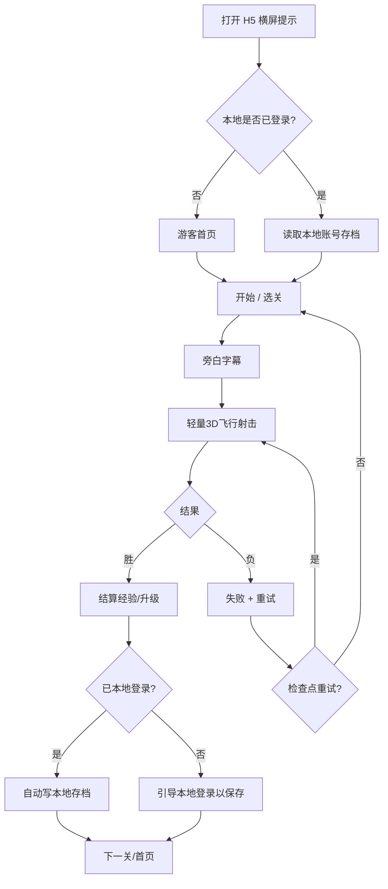
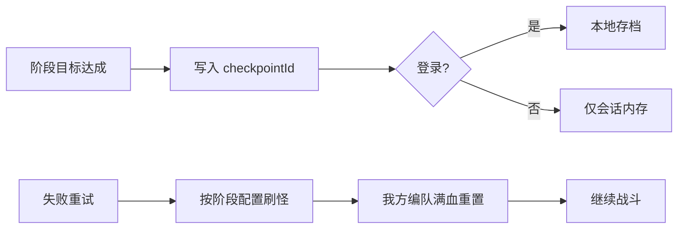
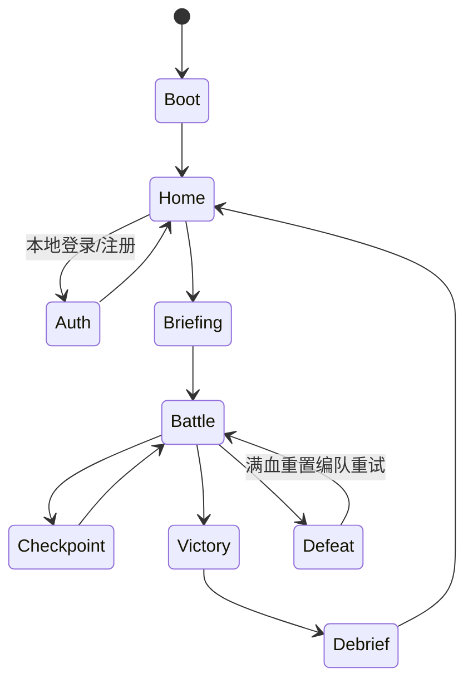

# 《中途岛：海空决战》产品需求文档（PRD）

版本号：V3.2.0

| 版本 | 时间 | 修订人 | 备注 |
|------|------|--------|------|
| V1.1 | 2026/11/14 | — | 儿童向横屏射击（历史骨架） |
| V2.0 | 2026/11/15 | — | 成年向竖屏写实重定位（需求梳理） |
| V3.0.0 | 2026/11/16 | PM | 青少年 / 简易 RTS / 单机+可选账号 / 旁白科普 / Demo |
| V3.1.0 | 2026/11/16 | PM | 本地模拟账号、现代演绎、横屏、对标视效、满血重置、体积约束；范式待选 |
| V3.2.0 | 2026/11/16 | PM | **锁定方案 A**：轻量 3D 飞行射击；**虚拟摇杆**；**不做重力感应**；废弃 RTS 为主玩法 |

**文档状态**：评审稿（V3.2 · 玩法已锁定）  
**本版本范围**：完整需求说明；**开发优先交付 Demo（关卡 1–2 + 核心循环）**；五关内容完整定义但非 Demo 必做。  
**与旧版关系**：以本版为准；V3.0「简易 RTS」主玩法废止，改为轻量 3D 飞行射击。

---

## 〇、已确认决议（累计）

| # | 议题 | 决议 |
|---|------|------|
| 1 | 账号 | **Demo 阶段采用本地模拟账号**（无后端真注册）；登录后进度写入本机按账号隔离的存档 |
| 2 | 时代演绎 | **确认现代演绎**：现代军械/战机质感讲述 1942 中途岛科普故事线 |
| 3 | 屏向 | **手机横屏**为主（画面信息更充分）；桌面可拉伸适配 |
| 4 | 视觉对标 | **视角、画风、战斗机建模**参考《现代空战 3D：战队版》的科技感与 3D 战机表现；**不对标其联机/PVP** |
| 5 | 检查点 | **阶段开始：我方编队满血重置**；敌方恢复为该阶段配置 |
| 6 | 联机 | **本阶段不考虑多人联机**；纯单机浏览器小游戏 |
| 7 | 技术约束 | 纯前端；**选型必须控制包体与运行时体积**，适配手机浏览器 |
| 8 | 玩法范式 | **方案 A：轻量 3D 飞行射击**（第三人称追逐镜头） |
| 9 | 操控 | **虚拟摇杆转向**；**不做重力感应**；不做复杂特技必选项 |
| 10 | 原 RTS | 不作为主玩法；僚机最多 AI 跟随，无点选编队 RTS |

---

## 一、概述（为什么做）

### 1.1 产品概述及目标

#### 1.1.1 背景介绍

中途岛战役是太平洋战争的转折点，具备清晰的时间线、戏剧冲突与可教学节点。产品目标是做一款：

1. **可玩的海空对抗**（有成长、有技能，而非纯旁白阅读）；
2. **面向青少年的历史科普**（旁白字幕讲清因果，而非只打斗）；
3. **轻量纯前端、手机横屏浏览器可玩**；
4. **科技感画面**接近《现代空战 3D：战队版》的战机与 HUD 气质，但体量为「小游戏」级；
5. **可选本地账号存档**，降低丢进度挫败。

#### 1.1.2 产品概述

《中途岛：海空决战》是一款运行于**手机横屏浏览器**的**单机轻量 3D 空战**网页游戏。玩家用**虚拟摇杆**驾驶现代演绎风格战机（第三人称追逐视角），对战敌机并袭击驱逐舰、航母群；击毁目标获经验，升级血量与机型，使用「地狱火导弹」「防护盾」。五关以**历史旁白 + 虚构关卡**串联中途岛科普故事线。游客可玩；**本地模拟登录后自动保存进度与检查点**。视觉与战机建模追求《现代空战 3D：战队版》式科技感，**不做联机、不做重力感应**。

#### 1.1.3 产品目标

**业务目标**

| 目标 | 指标 | 目标值 | 达成时间 |
|------|------|--------|---------|
| Demo 可演示 | 教程→战斗→升级→本地存档闭环 | 关卡 1–2 可通关 | Demo 里程碑 |
| 叙事有效 | 能复述战役核心因果 | Demo 内嵌 ≥3 个可测知识点 | Demo 内测 |
| 体积可控 | 首屏关键资源可控 | 见 §4.3（建议首包 gzip 后 ≤ 8–12MB 可玩）**[待确认]** | Demo |
| 完整版 | 五关 + 成长可通关 | 通关率 ≥ 60%（青少年样本）**[假设]** | 正式版 |

**用户目标**

| 目标用户 | 用户目标 | 衡量指标 |
|---------|---------|---------|
| 青少年 | 玩得爽且懂一点中途岛为何重要 | 通关后答对 ≥2/3 知识点 |
| 游客 | 零注册开玩 | ≤30 秒进入第一场战斗 |
| 本地登录用户 | 刷新后从检查点续玩 | 同账号恢复成功率 100% |

#### 1.1.4 目标用户

| 角色 | 描述 | 核心诉求 |
|------|------|---------|
| 青少年（约 12–17 岁） | 军事/历史兴趣，能接受一定操作与挫败 | 科技感画面、成长、故事 |
| 游客 | 不愿先注册 | 立刻开玩 |
| 本地账号用户 | 要存档 | 自动保存、续玩 |
| 研发/测试 | 验收 | 可复现关卡与体积指标 |

### 1.2 名词说明

| 名词 | 说明 |
|------|------|
| 现代演绎 | 用现代战机/导弹/护盾等表现讲述 1942 中途岛历史骨架与科普文案 |
| 方案 A | 轻量 3D 飞行射击：虚拟摇杆 + 第三人称追逐镜头 + 简化飞行模型 |
| 参考作 | 《现代空战 3D：战队版》：对标其**横屏 3D 战机观感、科技 HUD、建模气质**；不对标联机、赛季、重力感应、完整飞行模拟 |
| 检查点 | 关卡阶段目标达成后可恢复的进度点；恢复时**编队满血重置** |
| 地狱火导弹 | 主动技能：对目标/区域高伤害（冷却制） |
| 防护盾 | 主动技能：短时减伤或吸收伤害 **[假设：减伤护盾]** |
| 本地模拟账号 | Demo 无服务端；用户名（+可选密码）写入 localStorage，存档按账号键隔离 |
| Demo | 关卡 1–2 + 核心战斗循环 + 旁白 + 本地存档 |

### 1.3 角色及权限

| 角色 | 权限范围 | 数据范围 |
|------|---------|---------|
| 游客 | 开玩、选关、设置；无持久存档 | 仅当前会话 |
| 本地账号用户 | 游客权限 + 自动存档/读档 | 本机该账号槽位 |
| 系统 | 解锁关卡、写检查点、结算经验 | — |

### 1.4 文档阅读对象

| 对象 | 关注内容 |
|------|---------|
| 研发 | 3D 飞行操作、状态机、存档、体积预算、Three.js 选型 |
| UI/UX | 横屏 HUD、旁白、对标参考作的信息密度 |
| 测试 | 验收、存档、横屏适配、性能 |
| 美术 | 白底参考图 + 参考作气质的低模/压缩方案 |
| 策划 | 五关、旁白、数值 |

---

## 二、产品描述（做什么）

### 2.1 产品需求描述

1. **战斗层**：**轻量 3D 飞行射击**——虚拟摇杆驾驶长机；战机对战；袭击驱逐舰与航母群（Demo 侧重机+驱逐舰，航母可简化）。  
2. **成长层**：经验 → 血量与机型；技能地狱火、防护盾。  
3. **叙事层**：旁白字幕科普；关卡目标虚构，史实骨架真实。  
4. **账号层**：游客可玩；本地模拟登录后自动存档。  
5. **表现层**：横屏第三人称追逐视角；画风/战机建模参考《现代空战 3D：战队版》科技感。  
6. **技术层**：纯前端（建议 Three.js + 低模）；**强约束包体与性能**；无联机、无重力感应。

**非目标（本阶段明确不做）**

- 多人联机、实时 PVP、匹配、战队系统  
- 重力感应操控  
- 完整飞行模拟（失速、油量、眼镜蛇/筋斗等复杂特技必做）  
- 简易 RTS 点选编队（已废止为主玩法）  
- 对标《1942》《空战名将》画风  
- Demo 不做真后端账号与五关全内容  

### 2.1.1 玩法范式（已锁定：方案 A）

| 项 | 决议 |
|----|------|
| 范式 | **A. 轻量 3D 飞行射击** |
| 视角 | 第三人称后方追逐镜头（可轻微弹簧跟随） |
| 转向 | **虚拟摇杆**（左下） |
| 重力感应 | **不做** |
| 武器 | 机炮 + 地狱火导弹；防护盾为防御技能 |
| 锁定 | 进入前方锥体/准星范围自动辅助锁定 **[假设]** |
| 机炮开火 | **进入锁定或射程后自动开火**（降低操作负担）**[假设，可改按住射击]** |
| 编队 | 玩家控 1 架长机；0–2 架僚机 AI 跟随助攻（不可点选 RTS）**[假设 Demo 可先 0 僚机]** |
| 已否决 | 方案 B（俯视 RTS）、方案 C（混合指令）不进入 Demo 范围 |

### 2.2 产品整体流程

#### 2.2.1 主流程



#### 2.2.2 检查点与重置



#### 2.2.3 状态转换



### 2.3 全局说明

#### 2.3.1 异常处理

| 场景 | 处理 |
|------|------|
| 竖屏打开 | 显示「请横屏游玩」遮罩，锁定至横屏 |
| 本地存档写入失败 | Toast；保留内存进度 |
| 存档版本不兼容 | 回退关卡起点或最近合法检查点 |
| 切后台 | 自动暂停 |
| 游客刷新 | 进度丢失 + 登录引导 |
| 低端机掉帧 | 降特效档（关闭阴影/降粒子）**[假设]** |

#### 2.3.2 选关规则

- 五关顺序解锁；Demo 开放 1–2；3–5 显示「即将开放」**[假设，可改隐藏]**  
- Demo 重玩无经验衰减  

#### 2.3.3 全局交互

- **主适配**：手机**横屏**；触控热区 ≥ 48×48px  
- **旁白**：可跳过开场；结算保留至少 1 句历史收束 **[假设]**  
- **暂停**：继续 / 检查点重试 / 回首页  
- **语言**：Demo 仅简体中文  
- **联机入口**：无  

### 2.4 产品版本规划

| 版本 | 范围 | 目标 |
|------|------|------|
| **Demo** | 横屏；方案 A 飞行射击；关 1–2；升级与双技能；旁白；本地模拟账号存档；体积达标 | 可演示 |
| V1.0 | 五关；航母群完整；图鉴可选；存档稳定；视效档位 | 完整通关 |
| 后续 | 真账号后端、分享等（仍可不做联机） | 可选 |

### 2.5 产品框架

```text
┌──────────────────────────────────────────┐
│ 横屏启动 / 资源加载（分级：必载 / 延迟）     │
├──────────────────────────────────────────┤
│ 首页：开始 / 选关 / 本地登录 / 设置         │
├────────────┬─────────────────────────────┤
│ 旁白字幕    │ 横屏 HUD（摇杆/技能/锁定/雷达） │
│            │ Three.js 低模 3D 战场           │
├────────────┴─────────────────────────────┤
│ 结算 / 升级 / 存档提示                      │
├──────────────────────────────────────────┤
│ 本地模拟账号 · localStorage 存档            │
└──────────────────────────────────────────┘
```

### 2.6 功能清单

| ID | 功能 | 优先级 | 版本 |
|----|------|--------|------|
| F01 | 启动、横屏引导、首页 | P0 | Demo |
| F02 | 游客开玩 | P0 | Demo |
| F03 | 本地模拟注册/登录 | P0 | Demo |
| F04 | 选关解锁 | P0 | Demo（1–2） |
| F05 | 旁白字幕 | P0 | Demo |
| F06 | 虚拟摇杆 3D 飞行射击 | P0 | Demo |
| F07 | 敌战机、驱逐舰 | P0 | Demo |
| F08 | 航母群 | P1 | Demo 简化 / 正式完整 |
| F09 | 胜负与失败重试 | P0 | Demo |
| F10 | 检查点 + 满血重置编队 | P0 | Demo |
| F11 | 经验、血量、机型 | P0 | Demo |
| F12 | 地狱火导弹 | P0 | Demo |
| F13 | 防护盾 | P0 | Demo |
| F14 | 本地自动存档 | P0 | Demo |
| F15 | 暂停/设置/画质档 | P1 | Demo |
| F16 | 图鉴 | P2 | 正式版 |
| F17 | 成就 | P2 | 正式版 |
| F18 | 关卡 3–5 | P0 | 正式版 |
| F19 | 体积与性能降级策略 | P0 | Demo |

---

## 三、功能需求（怎么做）

### 3.1 F01 启动与首页

**用户故事**  
作为玩家，我希望横屏打开后尽快开玩。

**界面**：标题、开始、选关、本地登录、设置；首次进入可提示「建议横屏 + 戴耳机可选」。

**异常**：资源加载失败 → 重试；横屏检测失败 → 旋转提示。

---

### 3.2 F02 / F03 游客与本地模拟账号

**描述**  
Demo **不接真实后端**。用户可设用户名（可选简单密码）创建本机账号；存档键如 `midway_save_<username>`。

**用户故事**  
- 游客：不登录也能玩。  
- 本地用户：登录后进度保留在本机。

**数据字典（本地账号）**

| 字段 | 类型 | 必填 | 说明 | 示例 |
|------|------|------|------|------|
| username | string | 是 | 3–16 字符 | ace01 |
| passwordHash | string | 否 | 可选；Demo 可用简单哈希或明文标注仅本机 **[假设：可选密码]** | *** |
| createdAt | number | 是 | 时间戳 | 1731686400000 |

**界面**：用户名、密码（可选）、登录、注册、继续游客。

**异常**：重名 → 提示已存在；密码错误 → Toast。

**说明文案**：登录页注明「Demo：进度仅保存在本机浏览器，清除数据会丢失」。

---

### 3.3 F04 关卡选择

五关列表；Demo 仅 1–2 可进；顺序解锁。

---

### 3.4 F05 历史旁白字幕

**规格同 V3.0**：开场 / 阶段 / 结算；科普短句；可跳过开场。

**五关映射**

| 关卡 | 标题 | 史实锚点 | 虚构目标 | Demo |
|------|------|---------|---------|------|
| 1 | 云上的眼睛 | 破译与侦察 | 击落敌侦察/拦截，完成侦察任务 | ✅ |
| 2 | 岛上的风暴 | 空袭与防御 | 守基地 + 打驱逐舰 | ✅ |
| 3 | 勇敢的诱饵 | 牵制与牺牲 | 牵制敌机至计时结束 | 正式 |
| 4 | 决定性的五分钟 | 俯冲命中航母 | 突破护航打击航母群 | 正式 |
| 5 | 最后的反击 | 收束 | 清残余航母群 | 正式 |

旁白需点明：**本作以现代空战形式进行「作战推演」，历史骨架为 1942 中途岛。**

---

### 3.5 F06 战斗操控（方案 A · 已锁定）

**描述**  
横屏第三人称轻量 3D 飞行射击；虚拟摇杆转向；无重力感应。

**用户故事**  
作为玩家，我希望用左手摇杆驾驶飞机、右手点技能打仗，以便在手机上获得接近《现代空战 3D》的感觉。

| 操作 | 行为 |
|------|------|
| 左虚拟摇杆 | 控制俯仰/偏航（简化飞行模型，无真实空气动力学） |
| 加速 | Demo：**自动巡航** + 可选右侧加速键 **[假设]** |
| 减速 | Demo 可不做或弱化 **[假设：不做独立减速键]** |
| 机炮 | **锁定或进入射程后自动开火** **[假设]** |
| 地狱火 | 有锁定目标时点击发射（进入冷却） |
| 防护盾 | 点击开启，持续数秒 |
| 重力感应 | **禁用，无入口** |
| 视角 | 后方追逐第三人称；不可切换座舱视角（Demo） |

**编队**：**[假设]** Demo 可仅玩家单机；正式版可加 0–2 僚机 AI。失败：长机被击坠 / 基地被毁 / 任务超时等。

**HUD（横屏，信息密度学参考作但做减法）**

| 区域 | 内容 |
|------|------|
| 左下 | 虚拟摇杆 |
| 中 | 3D 战场 + 准星/锁定框 |
| 右下 | 地狱火、防护盾、加速（若有） |
| 右上 | 暂停、小雷达 |
| 上 | 任务目标、基地/舰船血量、自身装甲 |
| 下 | 旁白字幕（出现时） |

**单位**

| 单位 | 说明 |
|------|------|
| 战斗机 | 我/敌；对空强、对舰弱 |
| 驱逐舰 | 敌；高 HP、防空 |
| 航母 | 敌；超高 HP，可产敌机 **[假设]** |

---

### 3.6 F09 / F10 失败重试与检查点

| 规则 | 说明 |
|------|------|
| 触发 | 阶段目标完成 |
| 恢复 | **我方按阶段预设编队满血重置**；敌方用该阶段配置 |
| 游客 | 仅会话内 |
| 本地登录 | 自动写入 localStorage |

失败菜单：检查点重试 / 整关重来 / 返回。

---

### 3.7 F11 成长

击毁获经验；升级提升 **血量** 与 **机型**；跨关继承（写入存档）。

| 目标 | 基础经验（建议） |
|------|-----------------|
| 敌战斗机 | 10 |
| 驱逐舰 | 40 |
| 航母 | 100 |

技能解锁节奏 **[假设]**：L2 地狱火，L3 防护盾。

**数据字典（growth）**

| 字段 | 类型 | 必填 | 说明 |
|------|------|------|------|
| level | number | 是 | 等级 |
| exp | number | 是 | 经验 |
| maxHpBonus | number | 是 | 血量加成 |
| craftId | string | 是 | 机型 |
| skillHellfireLv | number | 是 | 导弹等级 |
| skillShieldLv | number | 是 | 护盾等级 |

---

### 3.8 F12 / F13 技能

| 技能 | 效果建议 | 冷却建议 |
|------|---------|---------|
| 地狱火 | 对锁定目标/区域高伤，对舰加成 | 20–30s |
| 防护盾 | 3–5s 减伤约 50% | 25–35s |

---

### 3.9 F14 本地自动存档

**触发**：关卡开始、检查点、胜利结算、升级、回首页。

| 字段 | 类型 | 必填 | 说明 |
|------|------|------|------|
| saveVersion | number | 是 | 存档版本 |
| username | string | 是 | 本地账号 |
| currentLevelId | number | 是 | 关卡 |
| highestUnlocked | number | 是 | 解锁 |
| checkpointId | string | 否 | 检查点 |
| growth | object | 是 | 成长 |
| updatedAt | number | 是 | 时间 |

---

### 3.10 F08 航母群

正式版多阶段；Demo 可用简化单航母或仅背景威胁。

---

## 四、非功能需求

### 4.1 安全与合规

- 青少年向；允许爆炸与交战表现；避免过度残忍人体细节。  
- 旁白标明现代推演 + 历史科普。  
- Demo 本地账号：提示数据仅存本机。  
- 无内购广告；无联机。  
- 徽标/涂装合规 **[待确认美术]**。

### 4.2 埋点（可先本地）

`app_open` / `level_start` / `narration_skip` / `level_checkpoint` / `level_fail` / `level_retry` / `level_clear` / `level_up` / `skill_use` / `auth_local_login` / `save_success`

### 4.3 性能与体积（重点）

本产品是**仿《现代空战 3D》气质的浏览器小游戏**，不能按原生 App 体量做。

| 项 | 建议目标 **[待确认可调]** |
|----|--------------------------|
| 首包（gzip 后达到可进首页） | ≤ 3–5MB |
| 进战斗前必载（gzip） | ≤ 8–12MB（含低模） |
| 战斗帧率 | 中端机 ≥ 30 FPS，目标 60 |
| 同屏实体 | ≤ 12–16（含敌机与舰） |
| 模型 | 低模 + 压缩纹理（WebP/Basis 等）；单战斗机建议尽量低面数 |
| 特效 | 粒子有档位；低档关阴影 |
| 音频 | BGM 延迟加载；SFX 精简 |

**技术选型（已按方案 A 定稿）**

| 方向 | 结论 |
|------|------|
| 推荐 | **Three.js + 自研飞行/战斗逻辑**（易控体积、生态成熟） |
| 不优先 | Babylon.js（偏重）、完整物理引擎、联机 SDK |
| 资产 | glTF 低模 + Draco/Meshopt 压缩；禁止未压缩影视级资产 |
| 操控 | 仅虚拟摇杆组件；**不引入 DeviceOrientation** |

**降级策略**：检测 FPS &lt; 25 连续 N 秒 → 自动切低画质。

### 4.4 数据存储

| 数据 | 位置 | 周期 |
|------|------|------|
| 游客 | 内存 | 会话 |
| 本地账号存档 | localStorage | 直到清缓存 |
| 设置 | localStorage | 长期 |

### 4.5 系统集成

| 集成 | Demo |
|------|------|
| 账号 | **仅本地模拟** |
| 存档 API | 无 |
| 联机 | **无** |
| CDN | 可选，非必须 |

### 4.6 美术与参考约束

1. 用户提供战斗机 / 航母 / 驱逐舰**白底参考图** → 造型与质感基准。  
2. **整体气质**对齐《现代空战 3D：战队版》：科技 HUD、现代战机体量感、横屏信息布局；**不是**复制其 UI 资源或商标。  
3. 场景：海洋 + 天空可读即可，服务战斗信息，不做开放世界。  
4. **已确认**：现代外形 + 中途岛科普旁白的演绎关系成立。  

---

## 五、附录

### 5.1 验收标准

#### Demo 必过

| # | 验收项 | 通过标准 |
|---|--------|---------|
| 1 | 游客开玩 | ≤30s 进关卡 1 |
| 2 | 横屏 | 竖屏有提示；横屏可完整操作 |
| 3 | 虚拟摇杆 | 摇杆可转向；无重力感应选项 |
| 4 | 3D 视角 | 第三人称追逐镜头可玩 |
| 5 | 空战 | 可锁定/击落敌机 |
| 6 | 对舰 | 关 2 可摧毁至少 1 艘驱逐舰 |
| 7 | 旁白 | 关 1–2 开场+结算有科普字幕 |
| 8 | 双技能 | 地狱火、防护盾可用且有冷却 |
| 9 | 成长 | 至少升级 1 次并改血量或机型 |
| 10 | 检查点满血重置 | 失败重试后我方满血阶段编队 |
| 11 | 本地存档 | 登录→检查点→刷新→恢复 |
| 12 | 游客不持久 | 刷新丢失并引导登录 |
| 13 | 无联机 | 无匹配/房间/联网对战入口 |
| 14 | 爆炸反馈 | 击毁有爆炸特效 |
| 15 | 体积 | 达到 §4.3 约定阈值 |

### 5.2 Demo 关卡草案

**关 1**：摇杆教学 → 击落数架敌机 → CP1 → 再一波 → 胜。  
**关 2**：守基地（防空）→ CP1 → 用导弹/机炮打驱逐舰 → 胜。

### 5.3 参考作对标边界

| 对标 | 不对标 |
|------|--------|
| 横屏 3D/科技战机观感 | 4v4/排位/战队 |
| 战机建模气质、锁定/雷达类 HUD 信息感 | 眼镜蛇等复杂特技必做 |
| 导弹+防御类技能体验 | 百机库、内购、赛季 |
| 海战任务打舰感觉 | 原生 App 画质与包体 |

---

## 待确认项清单

### 必须确认（建议尽快，不再阻塞文档定稿）

1. **[假设待确认]** 机炮：锁定后**自动开火**是否 OK？若否改为按住射击。→ 见 §2.1.1 / §3.5  
2. **[待确认]** 首包/进战斗体积是否按 §4.3 建议值验收？  
3. **[假设待确认]** Demo 是否先做**单机长机**（无僚机 AI），正式版再加僚机？  

### 已确认（关闭）

- Demo 本地模拟账号  
- 现代演绎 1942 故事  
- 手机横屏  
- 视效/建模参考《现代空战 3D：战队版》，不做联机  
- 检查点阶段满血重置编队  
- **玩法方案 A：轻量 3D 飞行射击**  
- **虚拟摇杆；不做重力感应**  
- 方案 B/C 不进入 Demo  

### 建议确认

4. 游戏正式名是否「中途岛：海空决战」？  
5. 防护盾：减伤 vs 吸收盾？  
6. 关卡 3–5：显示「即将开放」还是隐藏？  
7. 仅字幕+SFX，还是要 BGM/语音？  
8. 图鉴是否进 Demo？  
9. 是否要独立加速键，还是全程自动巡航？  

### 可后续补充

10. 埋点是否上报  
11. 正式版是否上真账号后端（仍可不做联机）  
12. 数值表、旁白文案表、低模面数规范  

---

**下一步**：玩法已锁定，可进入 Demo 技术选型与关卡 1 原型（Three.js + 虚拟摇杆 + 低模）。请确认机炮是否采用「锁定后自动开火」。
